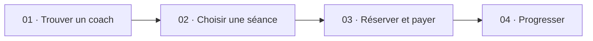

  

  <strong>Rendre le coaching sportif individuel plus accessible.</strong> 
  Une vision produit pour connecter les sportifs aux coachs qui les feront progresser.

  
  

  <a href="#la-vision">La vision</a> · <a href="#le-parcours-cible">Le parcours</a> · <a href="#explorer-le-projet">La documentation</a> · <a href="https://github.com/christopherfordant">Le créateur</a>

---

## La vision

Trouver un coach devrait être le début du progrès. GetYourMentor vise une expérience simple : découvrir un professionnel adapté, comprendre son offre et réserver une séance en confiance.

| Pour les sportifs | Pour les coachs | À terme, pour les clubs |
| :--- | :--- | :--- |
| Trouver un accompagnement adapté à leur sport, leur niveau et leur budget. | Présenter leur expertise et simplifier la gestion de leur activité. | Structurer une offre de coaching et créer de nouvelles collaborations. |

## Le parcours cible

**Une priorité : réduire la distance entre l’envie de s’entraîner et la première séance.**

## Un MVP concentré sur l’essentiel

| Étape | Fonctionnalités prévues |
| :--- | :--- |
| **Découvrir** | Recherche par sport et localisation, profils, tarifs et éléments de confiance. |
| **Réserver** | Choix d’une séance, disponibilité ou demande de créneau, confirmation et paiement. |
| **Accompagner** | Espace sportif, gestion des demandes côté coach et avis après séance. |
| **Opérer** | Vérification des coachs et suivi des réservations dans un back-office minimal. |

> **État du projet : conception et préparation du MVP.** Ce dépôt rassemble le cadrage produit, les parcours, les spécifications et des éléments d’architecture. Les fonctionnalités décrites sont des objectifs de développement ; ce dépôt ne fournit pas encore une application complète à lancer.

## Explorer le projet

| Point d’entrée | Ce que vous y trouverez |
| :--- | :--- |
| [Document maître](DOCUMENT_MAITRE_GYM.md) | Vision, périmètre du MVP et priorités. |
| [Écrans du MVP](MVP_ECRANS_GYM.md) | Parcours et spécifications écran par écran. |
| [Direction Figma](FIGMA_MAQUETTE_GYM.md) | Préparation de la maquette et validation de l’expérience. |
| [Architecture mémoire](ARCHITECTURE_MEMOIRE_GYM.md) | Organisation proposée des données et de la mémoire du projet. |
| [Schéma Supabase](SUPABASE_SCHEMA_GYM.sql) | Base SQL de travail. |
| [Workflows n8n](N8N_WORKFLOWS_GYM.md) | Automatisations envisagées pour les opérations. |
| [Organisation Trello](TRELLO_SETUP_GYM.md) | Structuration du travail et suivi des actions. |

## Les prochains caps

- [ ] Valider le périmètre et les disciplines prioritaires.
- [ ] Tester une maquette courte du parcours de réservation.
- [ ] Construire le cœur du MVP et vérifier l’expérience de bout en bout.
- [ ] Recueillir les retours des premiers coachs et sportifs pilotes.

---

  <strong>Une ambition sportive. Une approche produit. Des étapes concrètes.</strong>  
  Porté par <a href="https://github.com/christopherfordant">Christopher Fordant</a> 
  Échanger sur le projet : ouvrir une discussion via les issues du dépôt.

