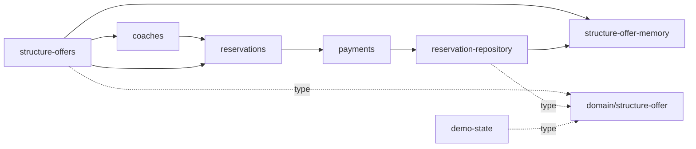

# ARC1 — cycle métier supprimé, 6 novembre 2026

## Résultat

Le cycle de cinq modules identifié dans l'audit du 5 novembre est supprimé par une extraction minimale. Aucun changement de règles, migration, paiement, notification, accès distant ou déploiement. Base `2a6063b5d702bad0a4dc95f9d5df0f6193a4b079`, branche `design/refonte-progressive-lot1`. Les changements antérieurs d'autres sessions restent hors de ce lot.

## Cause et correction

Avant : `coaches → reservations → payments → reservation-repository → structure-offers → coaches`. Le repository avait besoin du type `StructureOffer` et du tableau de démo ; il importait pour cela tout le service, qui dépend lui-même des coachs et réservations.

- Nouveau `gym-next/lib/domain/structure-offer.ts` : contrat de données extrait à l'identique, aucune dépendance de service.
- Nouveau `gym-next/lib/repositories/structure-offer-memory.ts` : **le même tableau local existant**, déplacé et partagé par import. Aucun second tableau, cache supplémentaire ou registre global ajouté.
- `reservation-repository.ts` importe directement le tableau de données et le type, sans passer par le service.
- `structure-offers.ts` utilise ce même tableau et réexporte le type et le tableau sous leurs anciens noms. Cette façade conserve les consommateurs existants, sans import de retour depuis le repository.
- `demo-state.ts` importe le type depuis le domaine. Le fonctionnement du stockage hébergé n'est pas modifié.

Les corps de fonctions, signatures et traitements de `structure-offers` et `reservation-repository` sont identiques avant/après, hors imports et extraction. Le texte du type extrait est identique. Comparaison automatique dans [contracts.json](assets/architecture-cycle-2026-11-06/contracts.json). Les tests utilisant les anciens exports continuent à fonctionner ; aucune migration globale des consommateurs n'est nécessaire.

## Modes préservés

| Mode | Source des offres et réservations | Résultat contrôlé |
|---|---|---|
| Démo locale autorisée | Tableaux process-local existants | Service et repository partagent le même objet ; capacité, remplissage et chevauchement restent contrôlés |
| Document démo | Offres et réservations du même DemoState | Chemin de mutation injecté testé : la capacité du document prévaut sur celle du tableau local, sans écrire dans les réservations locales |
| Supabase configuré | Requêtes et protections persistées existantes | Fetch simulé uniquement : pas de reprise de la capacité démo ; réservation groupée toujours refusée dans ce stockage non pris en charge |
| Production sans configuration | Aucun fallback autorisé | Création/listage refusés ; pas de bascule silencieuse en mémoire |

Le test du document utilise le port `demoMutate` existant ; **aucun appel Netlify Blobs réel** ni nouvelle recette complète du mode hébergé. Supabase est simulé avec une URL `.invalid` interceptée par un mock. Les quatre nouveaux tests bloquent les appels réseau inattendus. Les variables de services et coffres ne sont pas héritées par le lanceur de tests local.

## Contrôles et résultats

1. **Avant modification : 3 tests existants PASS** : dates/durées/remboursements aux limites, participants, capacité pondérée avec concurrence et libération des places.
2. **Après : 8 tests PASS** : les 3 précédents, l'affiliation/sélection de coach existante et 4 nouveaux contrats dans `tests/structure-offer-cycle.spec.ts`. Ces contrats couvrent partage des offres/capacité et chevauchement, document démo, séparation persisté/démo et refus du fallback en production.
3. **Analyse statique avec la méthode de l'audit** : avant 385 sources / 681 imports internes / un groupe cyclique ; après 388 sources / 686 imports / **zéro groupe cyclique**. La hausse inclut les deux modules et le test. Même parseur TypeScript, exclusions de l'audit et traitement des imports de types. [Avant](assets/architecture-cycle-2026-11-06/dependencies-before.json), [après](assets/architecture-cycle-2026-11-06/dependencies-after.json).
4. **TypeScript des sources actives : aucune erreur**, en excluant uniquement `playwright-artifacts` du programme de contrôle, sans changer le tsconfig du projet.
5. **Commande TypeScript globale : échec**, 20 diagnostics dans les copies historiques de `gym-next/playwright-artifacts`. Comparaison via CompilerHost : anciennes versions des trois fichiers rétablies uniquement en mémoire et nouveaux fichiers exclus pour la référence ; exactement les mêmes 20 diagnostics avant et après. [Comparaison](assets/architecture-cycle-2026-11-06/types.json). Aucun défaut global caché ni archive corrigée dans ce lot.

L'analyse ne couvre pas les imports dynamiques/require ni les dépendances tierces : zéro cycle dans le graphe étudié ne signifie pas absence universelle de cycle. Un premier lancement de tests a sélectionné trop largement un scénario API nécessitant un serveur : échec de configuration `Invalid URL`, pas une régression métier. Le filtre a été resserré et les 8 tests prévus rejoués avec succès. Un premier filtre avait aussi omis des noms accentués ; les résultats partiels ne sont pas comptés comme validation finale.

Pas de build Next exécuté : la résolution des consommateurs est couverte par TypeScript actif et les imports exécutés par les tests ; le contrôle global reste bloqué par les archives. Aucun succès de build ou validation globale production revendiqué. Aucun scénario navigateur du paiement, inférence RAG ou opération financière rejoué.

### Reproduction des tests ciblés

Avec Node et les dépendances déjà installées, dans un environnement local **sans accès de services**, utiliser Playwright avec une configuration sans webServer, testDir `gym-next/tests`, un seul worker. Sélection : `group-booking-foundation.spec.ts`, `booking-consolidation.spec.ts`, `structure-coach-selection.spec.ts`, `structure-offer-cycle.spec.ts`, filtre `participants :|capacit.*pond|dates strictes|ARC cycle|choix du coach :`. Le lanceur de cette exécution et la comparaison TypeScript sont conservés dans `delivery-private/run-arc-checks.mjs` et `delivery-private/arc-types.cjs`, hors Git. Les tests applicatifs et les preuves expurgées sont versionnés.

## Kanban et périmètre de clôture

`PROPOSITION-ARC-01` était une proposition, pas un ticket déjà validé. Aucun ticket équivalent trouvé au démarrage. Nouveau parent `GYM-ARC1`, quatre enfants : référence, extraction, vérifications, documentation/préparation de livraison. Responsables simulés et estimations proposées, `actualHours=null`. Clôture uniquement après les preuves ci-dessus et contrôle du tableau. A5/H1 et la recette distante ne sont pas clôturés.

Les 20 erreurs TypeScript historiques restent une limite explicite de la vérification globale ; elles ne sont pas réintroduites par cette extraction. La clôture ARC1 concerne le cycle et ses contrats locaux, pas la préparation globale d'une release.

Les 35 tests de l'atelier/Kanban passent. Le tableau a été vérifié avec Playwright sur ordinateur et mobile dans des contextes neufs : parent et quatre enfants terminés, aucune surcharge manuelle ; H1 en cours et A5 en backlog conservés. Les brouillons du navigateur utilisateur ne sont pas modifiés. [Preuve](assets/architecture-cycle-2026-11-06/kanban.json), aperçu local `http://127.0.0.1:4325/`.

## Retour arrière et suite

Revenir uniquement sur les cinq fichiers de production concernés (trois imports/façade et deux nouveaux modules) et le test ajouté, dans un commit dédié ; aucune restauration de données ni migration nécessaire. Ne pas écraser les modifications des autres sessions ou réinitialiser le dépôt.

Prochaine action recommandée : lot distinct pour clarifier le périmètre des sources actives et archives dans le contrôle TypeScript, après inventaire des consommateurs de ces archives. Ne pas déplacer les copies ni modifier le tsconfig dans le présent lot. Les autres recommandations de l'audit restent proposées, non exécutées.
