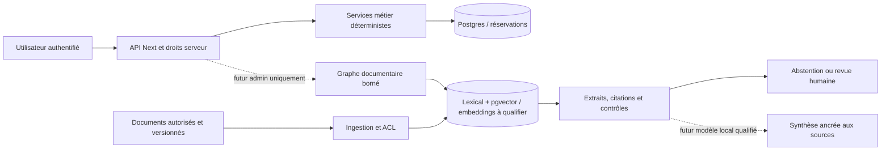

# Refonte agentique — audit et premier lot local

Date de départ : **3 novembre 2026**, Europe/Madrid. Base Git : `c2b4cbb`, branche de livraison `design/refonte-progressive-lot1`, chantier isolé `C:/Users/cashe/Documents/GYM-agentic-20261103`.

## Résultat et limites

Un atelier local avec Kanban, sous-tickets, répartition par rôle et assistant documentaire extractif fonctionne à `http://127.0.0.1:4325/`. Il réemploie le manifeste RAG et la logique lexicale du projet. Ce n'est ni une refonte applicative achevée, ni une intégration LangGraph, ni un système d'embeddings. Aucun agent de développement supplémentaire n'a été lancé. Les rôles du Kanban sont une simulation d'organisation.

L'outil n'est pas ajouté au site public : il expose des extraits de documentation interne au propriétaire du poste, via loopback et origine contrôlée. Ce mécanisme ne remplace pas une authentification applicative multi-utilisateur. L'intégration future à une console admin doit utiliser la session serveur existante, pas un rôle envoyé par le navigateur.

Réservations, paiements, notifications, éventail, portes et footer n'ont pas été modifiés. Stripe/Telegram restent dans l'état décrit dans [le rapport précédent](../STRIPE_TELEGRAM_2026-11-03.md) : accès et réception des événements encore à raccorder. Aucun déploiement, ingestion distante, migration, téléchargement de modèle ou appel LLM.

## Inventaire ciblé dans Documents

L'inventaire a porté sur les noms de dossiers et les README/configurations pertinents ; il ne s'agit pas d'une fouille exhaustive des données personnelles.

| Origine | Éléments examinés | État réellement vérifié | Décision de réemploi |
|---|---|---|---|
| `GetYourMentor/gym-next/lib/knowledge` | `context-assembler.ts`, routes search/context | Code d'assemblage par rôle et RPC lexicale ; pas d'agent exécuté par ces fichiers | Conserver les contrats et la séparation des instructions et sources |
| `GetYourMentor/docs/architecture` | manifeste, huit questions, readiness, architecture mémoire | Huit documents gouvernés ; évaluation locale exécutée : **7/8**, pas de preuve distante actuelle | Réutiliser corpus et questions ; corriger le défaut avant intégration |
| `GetYourMentor/supabase/schemas/memory.sql` | tables, recherche, droits | Extension vector et colonne `vector(1536)` préparées, recherche lexicale `security invoker`, exécution réservée au service role | Préférer cette base au déploiement d'une deuxième base ; dimension non justifiée par un modèle actif |
| `systeme_agentique_prompt` | README, `atelier/engine.py`, `planning.py`, connecteur, début du test workflow | Véritable code Python : tâches SQLite, dépendances, annulation par epoch, tentatives bornées, connecteur démo/Ollama. Pas exécuté pendant cet audit | Réemployer les principes de graphe, journal et limites ; ne pas recopier le service Python dans Next sans besoin |
| `cour_orchestrateur_ia` | README et package.json | Vitrine NŌMA studio en React/Vite ; son nom ne prouve aucune orchestration | Exclu de l'architecture agentique |
| `projet_automatisations` | index documentaire et `docs/RAG_KNOWLEDGE_BASE.md` | RAG local documentaire LinkedIn décrit, sources et index JSONL ; moteur non recetté ici | Réemployer provenance, reprise et mises à jour ; ne pas ingérer les archives personnelles/vidéos |
| `GYM-tooling` | inventaire racine | Contient `rea-6.5.0` ; présence ne prouve pas installation ou raccordement | Pas de moteur REA ajouté |
| `product_builder_uncode` | inventaire racine | PDF de formation, pas de composant logiciel identifié | Documentation éventuelle, pas de dépendance |
| `apprentissage_ia`, `assistant_business_plan` | noms et inventaire limité | Pas de moteur agentique retenu dans ce périmètre ; contenus métier personnels non ouverts | Exclure du corpus |
| Dossiers `GYM-*` | `git worktree list` | Nombreuses copies rattachées au même dépôt à des SHA historiques | Préserver ; ne pas confondre avec des microservices ou agents actifs |

Un `ollama.exe` existe dans le PATH, mais `/api/tags` sur loopback était indisponible. Aucun modèle ni licence de modèle n'est donc qualifié. `psql` et `docker` n'ont pas été trouvés dans le PATH ; cela ne prouve pas leur absence sur tout le poste. Les anciens README indiquant une préproduction active ne constituent pas une vérification actuelle de Supabase.

## Architecture retenue

Le chemin métier reste déterministe. Une orchestration documentaire en lecture seule se situe à côté de lui. Son éventuelle génération ne pourra pas transmettre des appels de mutation aux services métier sans une nouvelle décision et des autorisations serveur.



**Réalisé aujourd'hui :** poste local → validation → chargement du manifeste → recherche lexicale → contrôle → citations ou abstention. Une seule recherche par requête, une requête serveur à la fois, limite de 240 caractères, cinq extraits maximum, délai de deux secondes, zéro appel modèle/embedding. Aucun outil shell, paiement, messagerie ou écriture métier n'est exposé.

### Choix techniques vérifiés

| Option | Intérêt | Décision de ce lot |
|---|---|---|
| Graphe natif Node sans dépendance | Étapes finies, facilement testables pour cette lecture seule | Retenu pour la première preuve ; Node local observé `24.14.0` |
| LangGraph JS | État, interruptions, reprise et mélange d'étapes déterministes/LLM | Candidat du sprint 3 si ces besoins sont démontrés ; version affichée par les releases consultées : **1.6.0**, non installée. SDK sous MIT, à distinguer des services hébergés et de leurs coûts |
| PostgreSQL + pgvector | Stockage existant, vecteurs et données relationnelles au même endroit | Cible préférée ; licence PostgreSQL vérifiée, version serveur/extension distante inconnue ; aucune migration effectuée |
| n8n et assemblage existant | Orchestration opérationnelle et contexte par rôle déjà documentés | Réutiliser hors du chemin critique, pas de nouveau moteur actif |
| Base vectorielle séparée / service agent hébergé | Apporterait un deuxième stockage ou un service externe | Non retenu sans besoin et budget démontrés |

Sources officielles consultées le 03/11/2026 : [LangGraph overview](https://docs.langchain.com/oss/javascript/langgraph/overview), [releases JS](https://github.com/langchain-ai/langgraphjs/releases), [licence du SDK](https://github.com/langchain-ai/langgraphjs/blob/main/LICENSE), [pgvector](https://github.com/pgvector/pgvector), [licence pgvector](https://github.com/pgvector/pgvector/blob/master/LICENSE). Ces consultations ne constituent pas une installation ou une recette de ces composants.

### Agents applicatifs et responsabilités

| Rôle applicatif | Entrée / sortie | Outil / accès | Arrêt et supervision | État |
|---|---|---|---|---|
| Assistant documentaire | Question bornée → extraits sourcés | Lecture du corpus gouverné, jamais les comptes clients | 2 s, abstention sans source, revue des contradictions | Flux déterministe local exécuté, pas un agent LLM |
| Synthèse documentaire | Extraits autorisés → réponse citée | Modèle local qualifié seulement, aucun outil de mutation | Une génération bornée, validation des citations, abstention si panne | Prévisionnel |
| Contrôle de réponse | Réponse et références → acceptation/revue | Comparaison des citations et règles fixes ; pas de pouvoir métier | Pas de boucle de correction illimitée | Prévisionnel |

Les agents de développement sont une autre catégorie : Architecture, RAG, Sécurité, QA et DevOps dans le tableau. Il s'agit d'une répartition planifiée ; l'exécution de ce lot est séquentielle conformément aux consignes du dépôt.

## Données, RAG et sécurité

Chaîne cible : manifeste approuvé → nettoyage et découpage → métadonnées (source, version, visibilité, statut, droits) → embeddings identifiés par modèle/version/dimension → index → filtre d'autorisation serveur → récupération → citations → synthèse éventuelle.

La tranche actuelle découpe par paragraphes et segments de 1 200 caractères, calcule un SHA256 de chaque document et reconstruit les candidats à chaque demande. Retirer un document du manifeste le retire de la recherche suivante ; une modification change sa version. Une source absente provoque une indisponibilité explicite. Les chemins réels doivent rester dans le dépôt ; seuls les fichiers Markdown du manifeste sont lus. Les contenus ne deviennent jamais des instructions exécutables.

Le tri exploite la correspondance de termes, puis la priorité à égalité. Le minimum de correspondance est un garde exploratoire, **pas une confiance sémantique calibrée**. Les paragraphes historiques du document maître ne sont pas automatiquement distingués des décisions actuelles : une synthèse décisionnelle n'est donc pas autorisée. Les contradictions restent affichées comme extraits séparés ; aucun détecteur sémantique universel n'est revendiqué.

Les tests d'injection couvrent quelques motifs connus, pas toutes les formulations adverses. La protection principale de cette version est structurelle : aucun modèle ou outil d'action n'exécute les contenus, et l'interface les rend en texte avec `textContent`. Pas de HTML documentaire exécuté, de logs de questions persistés, de fournisseur ou de clé chargée. La limitation loopback/Host/Origin réduit l'exposition de l'atelier, mais ne remplace pas une authentification pour un service partagé.

Avant les vecteurs : choisir et licencier un modèle local compatible avec les ressources, vérifier dimensions et version, jeu d'évaluation et abstention ; choisir un stockage local isolé. Une migration distante restera soumise à autorisation distincte. Aucun mélange de vecteurs de versions différentes : nouvel index, réingestion contrôlée, vérification, bascule réversible. Suppression/invalidation des sources avant leur restitution. Les sources privées ne doivent jamais entrer dans un index public.

## Sprints et capacité

Dates **proposées**, non contractuelles, pour une seule personne exécutant séquentiellement avec une hypothèse de 20 h/semaine. Les rôles ne multiplient pas cette capacité. Accès, interruptions et corrections peuvent déplacer les remises. Les durées sont des fourchettes de planification, pas un relevé de ce tour. Aucun temps par agent n'a été mesuré.

| Sprint | Fenêtre / remise proposée | Objectif et effort feuilles | Critère de sortie |
|---|---|---|---|
| S1 | 03–06 novembre 2026 | Audit, atelier, lecture seule, contrôles : 8–15 h | Preuves locales, backlog cohérent ; CI documentaire bloquée tant que la baseline est en défaut |
| S2 | 09–13 novembre 2026 | Embeddings/index isolé/évaluation : 10–16 h | Modèle et licences qualifiés, ACL et reindexation testées, comparaison au lexical |
| S3 | 16–20 novembre 2026 | Choix LangGraph et intégration admin : 8–14 h | Première intégration authentifiée, reprise et régressions ; aucun déploiement implicite |

Entrée S1 : dépôt et procédures lus, état Git préservé. Entrée S2 : audit et défauts de recherche compris, ressources qualifiées. Entrée S3 : preuves S2 et décision d'architecture actualisée. Démonstration de sprint : étapes rejouées, résultats observables, échecs et limites exposés, rétrospective des estimations sans inventer de consommation.

Le Kanban comporte **18 tickets dont 13 feuilles**, avec parent, rôle, priorité, dépendances, fourchettes, critères, preuves et prochaine action. Les parents ne sont pas additionnés à la charge des enfants. La mise à jour du JSON est manuelle et versionnée ; aucun ticket GitHub ou agent actif n'est simulé comme réellement créé. Les contrôles de hiérarchie empêchent de marquer un parent terminé avant ses enfants nécessaires.

## Vérifications et défauts ouverts

- Suite Node locale : **14/14 PASS** (autorisation avant lecture, citations exactes, absence/insuffisance, validation, injection/mutation, contradictions sans arbitrage, timeout/panne, filtrage, manifeste réel, suppression et chemins, intégrité Kanban, serveur/Host/Origin et bornes).
- Premier passage serveur : 13/14 ; le client `fetch` normalisait le Host du test. Test corrigé avec une vraie requête HTTP conservant l'en-tête ; garde serveur inchangée.
- Une relance alors que l'aperçu occupait déjà le port a été conservée dans `node-tests-port-conflict.txt`. Le serveur de test utilise désormais le port loopback séparé 4326 ; résultat final 14/14, sans arrêter les processus inconnus.
- Playwright : vues 1 440 et 390 px, 18 cartes, filtre S1 à 10 cartes, cinq rôles, détails, clavier, citations, abstention et absence de débordement de page. Le Kanban défile dans sa propre zone. Captures et observations sous `docs/assets/agentic-2026-11-03/`.
- Contrôle existant du corpus : **8 documents valides**. Ancienne évaluation lexicale : **7/8**, défaut `critical-path` (source attendue `memory-rag` absente du top 3). Questions et attentes non modifiées pour faire passer le contrôle.
- Nouvelle récupération par extraits sur ces mêmes huit questions : **6/8** couvrent toutes les sources attendues (`critical-path` et `mcp-safety` incomplets). Ce n'est pas une amélioration de qualité prouvée. Aucun holdout, score sémantique ou test d'embeddings revendiqué.
- L'application Next n'est pas modifiée par le lot ; aucun nouveau build ou recette générale métier annoncé. Les limites de TypeScript global dues aux archives du dossier principal restent celles du rapport précédent.

Le nouveau workflow GitHub Actions est **manuel**, borné à dix minutes, lecture seule, sans secret, fournisseur, ingestion ou déploiement. Actions checkout/setup-node épinglées aux SHA des tags v7 vérifiés par `git ls-remote`. Les commandes locales ont été exécutées, mais **aucun run GitHub Actions n'a été lancé**. Sa gate d'évaluation existante reste en échec : ticket GYM-A3.2 bloqué. Le workflow MVP existant conserve typage, build, tests métier et frontière client. [Pratiques de sécurité GitHub](https://docs.github.com/en/actions/reference/security/secure-use).

## Rejouer et reprendre

```powershell
cd C:\Users\cashe\Documents\GYM-agentic-20261103
node --test tools/agentic-workbench/tests/*.test.mjs
node tools/agentic-workbench/server.mjs
```

Ouvrir http://127.0.0.1:4325/ ; Ctrl+C arrête le serveur. `node tools/agentic-workbench/tests/browser-check.cjs` réutilise Playwright installé dans `gym-next/node_modules` et exige le serveur ouvert. Aucun npm install n'est nécessaire pour le serveur ou les tests Node. Ne pas déplacer l'atelier sous `public` ou l'ajouter à Netlify.

Prochaine tranche recommandée : améliorer le retrieval sur les questions en défaut et ajouter des questions inédites, puis qualifier modèle local et stockage isolé. Le choix LangGraph reste une décision à réexaminer sur ces preuves, pas une dépendance ajoutée pour son nom.

État Git : divergence préexistante conservée (distant observé `d50b9eb`), aucune fusion, rebase ou force-push. Commit local de livraison et tentative de push consignés dans les preuves Git. Les modifications antérieures restent préservées.

Preuve Git finale locale : `C:/Users/cashe/Documents/GYM-agentic-20261103/delivery-private/git-delivery.json` (hors index, pour pouvoir enregistrer le SHA du commit qui contient ce rapport). Les empreintes des 18 fichiers antérieurement modifiés ont été comparées après transfert : aucune modification de ces fichiers par ce lot.
