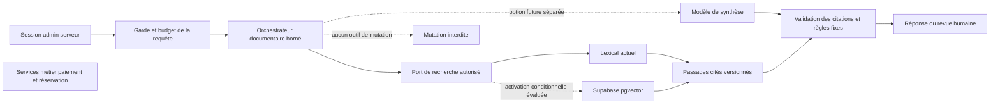

# Architecture cible et transition proposée

## Décision recommandée

Conserver le monolithe modulaire Next.js, Supabase + pgvector et les services déterministes. Une orchestration IA peut aider une **console admin documentaire** : retrouver une décision, préparer une synthèse citée, signaler une contradiction pour revue. Elle n'apporte pas encore de bénéfice démontré pour décider du paiement ou agir sur les réservations. Priorité à la fiabilité et aux annotations avant d'ajouter un modèle génératif.

Le plus petit incrément utile réutilise l'atelier : graphe borné `autoriser → valider → récupérer → contrôler → restituer/abstention/revue`. Ce graphe existe déjà sous forme de workflow fixe ; l'exposer correctement à l'admin améliore le produit sans prétendre créer un agent autonome. Si un besoin de choix d'outil est ensuite mesuré, ajouter **un seul agent documentaire en lecture**, sans multiplication de rôles exécutants. Comparer graphe natif et LangGraph seulement sur ce cas, conformément à A5.1 ; ne pas installer le framework par principe.



Le RAG fournit des preuves, pas des instructions de contrôle. Identité et permissions viennent exclusivement du serveur ; une source ne peut créer un outil. Limites de durée, nombre d'étapes et taille de contexte, annulation, identifiant de trace expurgé, arrêt si erreur ou absence de preuve. Pas de boucle de réflexion/correction illimitée. Un éventuel modèle génératif n'est pas un remplacement des gardes de code.

## Arborescence cible progressive, pas une migration à exécuter

```text
GetYourMentor/
├── AGENTS.md                         # règles racine, entrée conservée
├── DOCUMENT_MAITRE_GYM.md             # contrat canonique conservé
├── gym-next/
│   ├── app/                          # pages et routes API minces
│   ├── components/                   # UI active, par fonctionnalité
│   ├── lib/
│   │   ├── domain/                   # types et règles pures
│   │   ├── services/                 # cas d'usage : réservation, coach, paiement
│   │   ├── repositories/             # persistance, sans remontée vers services
│   │   ├── adapters/                 # Stripe, Telegram, Supabase, contrats explicites
│   │   ├── knowledge/                # recherche, citations, permissions, orchestration future
│   │   ├── fixtures/                 # données démo explicites, garde runtime conservée
│   │   └── policies/                 # autorisations et contrôles existants
│   ├── public/                       # uniquement fichiers destinés à être servis
│   ├── tests/                        # tests parcours et contrats
│   └── scripts/                      # contrôles/maintenance de l'application
├── tools/
│   ├── agentic-workbench/            # atelier local, pas publication web
│   └── payment-reconciliation/       # maintenance locale isolée
├── prototypes/                       # démonstrations locales non publiées, après audit des refs
├── supabase/
│   ├── schemas/                      # référence, statut documenté
│   ├── migrations/                   # seules migrations effectivement gérées
│   ├── proposals/                    # non applicables implicitement
│   └── verification/                 # contrôles et répétitions
├── scripts/                          # orchestration développeur, statut explicite
├── docs/
│   ├── ETAT_REPRISE_COURANT.md        # point de reprise conservé
│   ├── architecture/                 # décisions et contrats, index actifs/historiques
│   ├── audits/                       # diagnostics et propositions
│   └── assets/                       # preuves référencées et expurgées
├── governance/                       # politiques, état de développement et historiques
└── delivery-private/                 # local uniquement, jamais export public
```

Le stockage des documents commerciaux/personnels, outils installés et caches est à traiter par une politique de workspace distincte. Aucun déplacement de ces données proposé sans accord et inventaire. Un stockage hors dépôt peut être préférable, mais leurs consommateurs et backups doivent être vérifiés d'abord. Les worktrees GYM-* sont des checkouts Git légitimes ; ils ne sont pas des doublons à supprimer automatiquement.

## Correspondance des changements envisagés

| Actuel | Proposition | Raison / réemploi | Impact et condition |
|---|---|---|---|
| `lib/domain.ts` types + fixtures | `domain/types.ts`, `fixtures/coaches.ts` ; façade transitoire domain.ts | Domaine pur sans casser immédiatement les imports | Reexports temporaires, tests démo/public ; pas de changement de données |
| `lib/coaches.ts`, `reservations.ts` | `lib/services/*` après extraction des dépendances | Cas d'usage identifiables | Adaptation des imports et mocks ; ne pas mélanger déplacement et correction métier |
| `lib/payments.ts`, `stripe-connect.ts`, `telegram.ts` | Façade de service + adaptateurs spécialisés | Ports actuels réutilisés, appels externes séparés des décisions | Contrats de webhook/idempotence inchangés, tests négatifs ; pas de nouvelle opération financière |
| repository → structure-offers → coaches | Port d'accès aux offres / fixtures sans import de service | Casser le cycle statique, pas déplacer simplement le problème | Tests d'accès aux offres/capacité et réservation ; aucune modification de politique |
| `tools/agentic-workbench/retrieval.mjs` et routes knowledge | Contrat commun de récupération, adaptateurs distincts | Budget, citations, droits ; pas de suppression automatique de SQL/JS | A5.1/A5.2, tests Node/Next, pas de chargement de fichiers internes depuis une route publique |
| prototypes HTML dans `public/design_assets` | `prototypes/` pour les seuls fichiers non utilisés en production | Garder les médias réellement utilisés dans public | Inventaire des liens/URL et construction Next ; chemin de démonstration à mettre à jour |
| captures/inspecteurs racine | preuves datées / outils d'audit après index de références | Nettoyer les entrées sans perdre les preuves | Corriger les liens et scripts consommateurs ; aucune suppression |
| exports `project_readable`, documents historiques | Index des statuts et origines avant archivage éventuel | Éviter une seconde source de vérité | Vérifier recherche/manifeste/RAG/mempalace avant tout changement de chemin |

## Plan de transition et tickets proposés

Estimations **indicatives en heures d'ingénierie**, pas temps passé ni délai garanti. Prévoir revue et ajustement après cadrage. Les IDs ci-dessous sont des propositions de rapport, pas des cartes créées/validées.

| Lot | Ticket / lien au backlog actuel | Travail et critères d'acceptation | Estimation | Risque et retour arrière |
|---|---|---|---|---|
| Immédiat, comportement | PROPOSITION-ARC-01 | Casser le cycle de cinq modules, dépendances repository → service supprimées ; tests existants et contrat d'offres/réservation passent | 4–8 h | Écart démo/persisté ; retour au commit sans migration de données |
| Immédiat, gouvernance | PROPOSITION-ARC-02 | Index des scripts actifs/historiques, garde avant exécution Codex ; aucune ancienne boucle ne doit contourner la consigne courante | 2–4 h | Changement de procédure ; revue explicite, conserver anciens scripts jusqu'à décision |
| Immédiat, fichiers publiés | PROPOSITION-ARC-03 | Liste des assets réellement consommés, démos non nécessaires hors public, liens préservés, contrôle du build/export | 3–6 h | Liens/animations cassés ; déplacement inversable avec mapping |
| Consolidation, documentation | PROPOSITION-ARC-04 | Index actuel/historique/copie et matrice CI ; éviter les doublons de maîtres et identifier les futurs contrôles sur la branche active | 2–4 h | Perte de références ; aucun déplacement avant vérification des liens |
| Consolidation, types/démo | PROPOSITION-ARC-05 | Séparer types purs/fixtures via façade ; projection publique et refus des fallbacks inchangés | 3–6 h | Imports et comportement démo ; reexports puis retrait contrôlé |
| Qualité RAG | Réutiliser travaux de fiabilisation et annotations, pas recréer A4 | Relecture humaine des candidats, nouveau jeu réservé et mesure de découpage avant toute bascule vectorielle | 3–6 h + disponibilité de validation humaine | Surajustement du corpus ; maintenir lexical et anciennes preuves figées |
| Orchestration | **A5.1 existant** | Cas unique admin, comparaison graphe natif/LangGraph si justifiée, budget/arrêt/revue et traces expurgées | 4–8 h | Complexité et appels modèles ; aucun fournisseur ni téléchargement sans décision |
| Intégration | **A5.2 existant** | Session admin, feature flag par défaut désactivé, retrieval en lecture, tests non-admin/panne/injection/citations | 6–12 h | Exposition de documents ; désactiver le flag et revenir au commit |
| Recette IA | **A5.3 existant** | Mesures sur jeu réservé et documentation des cas manuels ; pas d'autonomie financière | 3–6 h | Validation insuffisante ; garder outil expérimental non public |

H1.2.3.3/.4 et H1.3/.4/.5 restent des chantiers existants de fiabilité métier. Cet audit n'autorise ni leur opération distante ni leur clôture. Ne pas retarder les protections métier au profit d'un agent démonstratif. A4 terminé ne signifie pas IA applicative terminée ; ses résultats bornés ne sont pas invalidés.

## Coûts et exploitation

Conserver l'extractif évite un coût d'inférence générative, mais pas les coûts de machine, base, stockage et maintenance. E5 existe déjà comme candidat local ; le script et les preuves doivent guider ressources/licence/version, sans nouveau téléchargement dans ce lot. Aucun tarif cloud ni disponibilité d'offre gratuite actuelle n'a été vérifié. Un futur modèle génératif exige un budget par requête/jour, suivi et limites serveur ; aucun compte payant n'est nécessaire à la correction du rangement ou du cycle.

## Trois actions à privilégier

1. Corriger le cycle métier avec tests ciblés et frontières stables.
2. Clarifier ce qui est actif, privé et publié : scripts, prototypes, entrées documentaires.
3. Faire valider les annotations RAG puis reprendre A5.1 sur un unique cas documentaire admin ; conserver le lexical tant qu'une bascule n'est pas démontrée.
