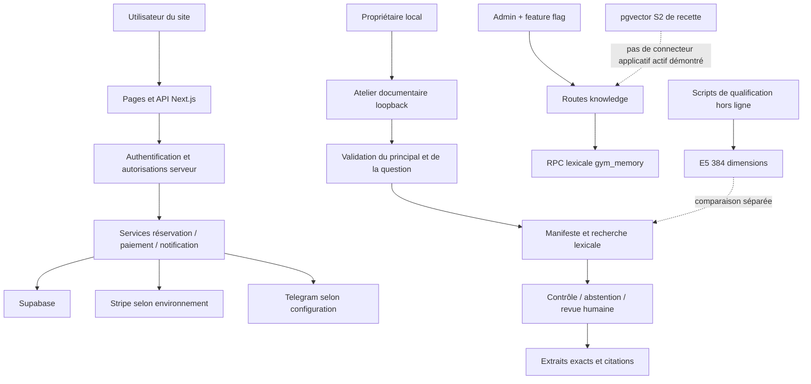

# Audit architecture et organisation — GetYourMentor

Audit local du 5 novembre 2026. Base : `91ac4ab2de162d08a68ccd84ef6ddbaaff2bc228`, branche `design/refonte-progressive-lot1`. Les modifications locales préexistantes font partie de l'état examiné, sans être approuvées ni intégrées au commit de cet audit. Aucun code déplacé, installation, secret ouvert, compte distant consulté ou nouveau service lancé.

## Verdict

**Architecture agentique partielle en préparation ; aucun agent IA autonome intégré au produit démontré.** Le projet n'est pas vide côté IA : il possède un assistant documentaire lexical réellement testable, un assemblage de contexte par rôle, un modèle d'embeddings qualifié historiquement et un stockage pgvector de recette préparé et historiquement vérifié. Mais ces éléments ne forment pas encore un agent applicatif qui choisit des outils sous supervision. A5 et ses trois sous-tickets restent en backlog.

Il existe aussi un **lanceur de missions Codex pour le développement**, distinct du produit. Il appelle réellement `codex exec` dans son code ; ce n'est donc pas seulement un dessin d'architecture. Son exécution actuelle, son modèle et ses résultats ne sont pas vérifiés par cet audit. Les rôles Architecture/RAG/Sécurité/QA/DevOps du Kanban ne prouvent aucun multi-agents. Les consignes actives interdisent de lancer des agents supplémentaires dans ce lot ; les scripts historiques n'ont pas été exécutés.

Le rangement est **structuré dans son noyau applicatif, encombré à l'échelle du dossier de travail**. Une refonte totale ou des microservices ne sont pas justifiés. Les priorités sont un cycle métier réel, la séparation des prototypes publiables, la lisibilité des documents et le périmètre des automatismes historiques.

## Étendue réellement couverte

- **41 288 répertoires et 306 968 fichiers recensés**, environ 5,69 Go logiques observés. Instantané non atomique, tailles indicatives, sans dédupliquer les liens physiques.
- L'énumération inclut les dépendances, caches, répertoires masqués et données privées **en métadonnées seulement**. Les contenus de coffres, comptes et dossiers personnels ne sont pas lus. Les descendants privés sont exclus du CSV publié.
- **456 chemins de répertoires projet** publiés dans [ARBORESCENCE.csv](ARBORESCENCE.csv). Les dépendances et dossiers privés sont regroupés dans [INVENTAIRE.json](INVENTAIRE.json).
- **385 sources analysées par AST TypeScript**, 681 dépendances statiques internes résolues, un groupe cyclique. Lecture sémantique ciblée des composants structurants ; les 385 fichiers n'ont pas tous fait l'objet d'une revue humaine ligne par ligne.
- **5 refus d'accès à des répertoires et 6 erreurs de métadonnées de fichiers** pendant l'énumération. Aucun accès forcé. Les descendants inaccessibles ne sont pas comptés. Le relevé ne permet pas d'affirmer que tous les fichiers physiques du disque sont connus.

`.tools` concentre 266 819 fichiers et environ 3,39 Go ; `gym-next` compte 16 507 fichiers, dépendances/builds compris ; `mempalace` 13 483. Le nombre de fichiers n'est pas une mesure de complexité métier. Les 102 fichiers à la racine mêlent contrats, captures et scripts d'inspection : c'est en revanche un problème d'orientation concret.

## Composants et niveau de preuve

| Composant | Déclencheur et fonctionnement | Modèle / outils / mémoire | État et frontière |
|---|---|---|---|
| Produit Next.js | Pages `gym-next/app`, composants et routes API ; services dans `lib` | Pas de modèle IA identifié dans les dépendances directes ou parcours IA examinés ; Supabase, Stripe, Telegram via services | Implémenté ; pas de nouvelle recette métier distante dans cet audit |
| Atelier documentaire | `tools/agentic-workbench/server.mjs` → `workflow.mjs` → `retrieval.mjs` | Zéro appel modèle/embedding ; manifeste de 8 documents, chunks versionnés, recherche lexicale ; état requête en RAM | Local vérifié par 35 tests ; pas un agent LLM ni un service public |
| Assembleur de contexte | `app/api/knowledge/context/route.ts` → `assembleContext` | Instructions fixes selon rôle, recherche SQL lexicale ; pas de synthèse ni choix d'outil | Code présent, feature flag et administrateur requis ; activation actuelle non vérifiée |
| Recherche applicative | `app/api/knowledge/search/route.ts` → RPC `search_document_chunks` | Recherche lexicale `gym_memory`, citations ; rôle serveur côté backend | Code présent ; aucun appel distant ni flag réel lu ici |
| Embeddings | `qualify_embeddings.py`, `compare_retrieval.py` | `intfloat/multilingual-e5-small`, conversion ONNX quantifiée Xenova, 384 dimensions, limite 256 tokens | Qualification/comparaison historiques archivées ; pas d'inférence relancée ni de génération LLM |
| Stockage vectoriel | Proposition S2 et scripts de vérification Supabase | Schéma privé `gym_rag_s2`, collections/sources/chunks, recherche exacte, RLS | Recette synthétique distante archivée du 4 novembre, vide à cette date ; état actuel non relu |
| Missions de développement | `scripts/run_auto_orchestrator.ps1` → `run_codex_mission_agent.ps1` | Sous-processus Codex, prompt de mission, fichiers d'état/preuves ; modèle non fixé dans ce script | Implémenté, exécution non vérifiée ; agent externe de développement, hors produit |
| Supervision et planification | Scripts PowerShell/Python, registre et statut de mission | Règles et choix d'étape déterministes, journaux fichiers | Code examiné ; pas une preuve de planification autonome par LLM |
| n8n | Six exports `n8n/workflows/*.json`, import et credentials à préparer | Synchronisation, brief, ingestion, décisions ; fournisseur IA prévu | Exports présents ; aucune instance active ni exécution vérifiée |
| Mempalace | `scripts/mempalace.ps1/.cmd`, configuration `mempalace.yaml` | Outil CLI local et états ignorés par Git ; contenus privés non inspectés | Présence/wrappers vérifiés ; pas de raccordement démontré aux routes du produit |
| MCP | `docs/mcp/MCP_TOOL_CONTRACT_GYM.md` | Contrat de lecture et permissions | Spécification ; pas de serveur MCP déployé par ce contrat |
| Réconciliation | `tools/payment-reconciliation` | Moteur déterministe, CLI et laboratoires SQLite/PostgreSQL/HTTP local | Preuves du lot précédent réutilisées ; pas un agent et pas connecté au parcours actif |

Sources structurantes : [workflow](../../../tools/agentic-workbench/workflow.mjs), [retrieval](../../../tools/agentic-workbench/retrieval.mjs), [contexte](../../../gym-next/lib/knowledge/context-assembler.ts), [lanceur Codex](../../../scripts/run_codex_mission_agent.ps1), [Kanban](../../../tools/agentic-workbench/backlog.json).

## Flux observés

Les sorties de recherche sont du contexte, jamais une permission. Aucun lien atelier → mutation de réservation n'a été trouvé dans les chemins examinés. La génération et la boucle de décision/outils nécessaires à un agent applicatif restent absentes de ces chemins.

## RAG : ce qui existe et ce qui manque

Le chargeur local limite le corpus à 16 documents maximum, actuellement 8, fichiers Markdown résolus dans le dépôt, 1 Mio par source. Chunks de 1 200 caractères, identifiants déterministes, empreintes de version, filtres de visibilité/statut, restitution au plus de 8 passages / 7 200 unités de texte JS, diversité de documents. Les instructions suspectes conduisent à une revue ; les demandes de mutation et correspondances insuffisantes à l'abstention. Le filtrage par motifs n'est pas une défense universelle ; l'absence d'outils exécutables est ici la protection principale.

La RPC historique est lexicale et contient une colonne `vector(1536)` préparatoire : cette dimension ne prouve pas un modèle actif. S2 isole le modèle 384 dans un autre schéma ; ne pas fusionner ni réétiqueter ces espaces. Les exports n8n contiennent une ingestion documentaire proposée, mais aucun flux d'ingestion réel activé n'est démontré par leur présence.

La décision A4.3 reste de conserver le lexical. La correction lexicale ultérieure de Jupiter est effective dans le code : [fiabilisation du 4 novembre](../../RAG_FIABILISATION_2026-11-04.md). Le rapport A4.3 décrit des échecs historiques, pas l'état courant de ce correctif. Les annotations réelles restent proposées, sans validation humaine ; la troncature de huit passages au-delà de 256 tokens est documentée et la nouvelle fenêtre n'est pas activée. Aucun score vectoriel n'est réévalué dans cet audit.

Pour aller vers un agent : un service de récupération autorisé doit fournir des passages structurés et cités à une exécution bornée. Le principal vient de la session serveur ; le modèle et les documents ne peuvent ni choisir un rôle plus puissant ni accorder un outil. Sans source fiable, en cas de contradiction ou panne : abstention/revue, pas d'action métier. L'intégration admin, les traces expurgées, les budgets et les évaluations restent des prérequis, pas des livraisons de cet audit.

## Contrôles exécutés dans ce lot

35 tests locaux de l'atelier/Kanban réussis ; évaluation lexicale historique 12/12 et contrôles 3/3 réussis sur le dossier courant. Analyse AST et inventaire réellement exécutés. Aucun nouveau test Stripe/Supabase, build complet, Playwright métier, inférence ou crash serveur. Les résultats financiers et PostgreSQL antérieurs sont des preuves réutilisées, pas des essais refaits.

Voir [constats et preuves](CONSTATS.md), [architecture cible et plan](CIBLE_ET_PLAN.md), [couverture détaillée](COUVERTURE.md), [dépendances](DEPENDANCES.json). Les propositions de tickets restent dans le rapport : aucun ticket métier n'est ajouté ou clôturé par cet audit.
